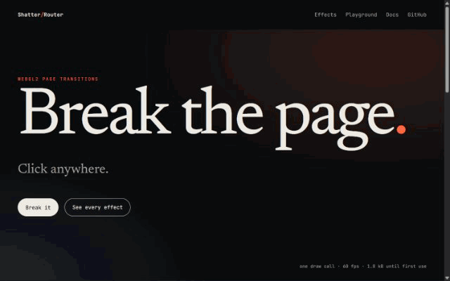

# Shatter Router

**Break the page.** WebGL2 glass-shatter page transitions for single-page apps: vanilla, React, React Router and Next.js.

**[Live demo and docs: shatter-router.vercel.app](https://shatter-router.vercel.app)**. Every link on the site breaks the page.



```bash
pnpm add shatter-router
```

```tsx
import { ShatterProvider, ShatterLink } from 'shatter-router/next';

<ShatterProvider>
  <ShatterLink href="/work">Work</ShatterLink>
</ShatterProvider>;
```

That's it: every `ShatterLink` navigation now captures the page, puts it under glass, renders the next route behind it and breaks the glass from the point you clicked. Back and forward too.

## Features

- **Seamless.** The first frame of every effect is the page itself: a capture of the live DOM on a pixel-exact camera. Seam tests on Chromium, Firefox and WebKit keep it under 0.5 % of pixels.
- **Sixteen ways to move.** Gravity (`shatter`, `crumble`, `rain`), force (`explode`, `implode`, `vortex`, `wind`), order (`flip`, `blinds`, `domino`, `slide`, `fold`), matter (`melt`, `ripple`, `glitch`) and `assemble`, each a lazy chunk of about 1 kB; eight fracture patterns; staggers; compose them, or write your own with the public effect interface (8 floats per shard and a GLSL function).
- **Seven materials.** `glass`, `ice`, `mirror`, `obsidian`, `paper`, `metal`, `holo`, or your own: crack propagation, thickness, edge light, a glint, frost, reflections, colour fringing, all exactly zero at rest.
- **Any router.** `shatter-router` (vanilla), `/react`, `/react-router`, `/next`; Back plays the exact reverse of the effect that brought you to a page, Forward replays it, with scroll restoration; the Next adapter waits for `loading.tsx` boundaries to settle.
- **Real physics, optionally.** `physics: rapier({ floor: true })` drops the shards into Rapier, loaded only when used.
- **Always navigates.** No WebGL2, reduced motion (a 200 ms crossfade instead), a slow capture, a strict CSP, an error anywhere: the page still changes.
- **Accessible.** Focus moves to the new page's heading, the new title is announced, Escape skips, links keep their native behaviour (modifier clicks, `target`, `download`).
- **Debuggable.** `debug: true` opens a panel with phase timings, FPS, draw calls, a wireframe and a seam check that diffs the glass against the live page.

## Performance

Measured, not promised. Laptop with an NVIDIA RTX 4050 Laptop GPU, Windows 11, Chrome; 1440×900, 160 shards. Details and methods: [`context/PROGRESS.md`](context/PROGRESS.md).

|               |                                                                     |
| ------------- | ------------------------------------------------------------------- |
| Up front      | **2.35 kB** min+gzip (core); 3.1–4.8 kB with an adapter             |
| Lazy, on idle | runtime 7.8 kB, renderer + all effects 19.8 kB, capture 12.5 kB     |
| Frame rate    | **60 fps** for every effect, worst frame ≤ 17.1 ms                  |
| Per frame     | **1 draw call**, **0 bytes** allocated in the render loop           |
| Capture       | **82 ms** median on the docs landing page (48–88 ms; 120 ms budget) |
| Fracture      | 0.6 ms for 160 shards                                               |
| Long tasks    | none over 50 ms while the shards move                               |
| Memory        | 100 transitions in a row: +0.1 MB heap, 0 live textures             |
| Docs site     | Lighthouse mobile: Performance 97–99, Accessibility 100             |

Every budget is enforced in CI: `size-limit` for the bundles, the e2e suite for draw calls, allocations and textures.

## Browser support

Any browser with **WebGL2** gets the effect; every other browser still navigates (crossfade or instant swap). Tested on every pull request on Chromium, Firefox and WebKit. The Popover API puts the glass above dialogs, with a fixed-position fallback. View Transitions provide the reduced-motion crossfade, with an instant swap otherwise. While the page is pinch-zoomed the effect is skipped. Small text antialiasing can differ slightly between the live page and the glass (ClearType on Windows Chromium; half-pixel line placement on Linux Chromium at 2×).

## Learn more

The docs site, [shatter-router.vercel.app](https://shatter-router.vercel.app) (source in [`apps/docs`](apps/docs)), covers getting started for each router, the API reference, writing a custom effect, performance, accessibility, CSP and troubleshooting.

Quick notes:

- Add `html { scrollbar-gutter: stable; }` so the page keeps its width while the glass is up.
- CSP: the capture needs `img-src data: blob:`; Rapier mode needs `script-src 'wasm-unsafe-eval'`. Without them the transition falls back, and navigation still works.
- `debug: { panel: false }` keeps the test hook and diagnostics without the panel. The panel's seam check asks to share the tab (the browser prompts) to compare real pixels.

## Roadmap

Not in v1, on purpose:

- Multi-page apps (cross-document navigation): the glass can't survive a page unload.
- Vue, Svelte and Solid adapters: the core is framework-agnostic, so they are thin.
- Capturing cross-origin iframes (drawn as their background colour today).
- Non-fracture effects (melt, pixel-sort, paper-fold): the effect interface can grow into them.
- Region transitions (`transition({ target })`), breaking one element instead of the viewport.

## Repository

| Path                                                         | What it is                                                                             |
| ------------------------------------------------------------ | -------------------------------------------------------------------------------------- |
| `packages/shatter-router`                                    | The library                                                                            |
| `apps/docs`                                                  | The docs site (Next.js), every link a `ShatterLink`                                    |
| `examples/vanilla`, `examples/react-router`, `examples/next` | Example apps the e2e suite runs against                                                |
| `e2e`                                                        | Playwright tests: seams, effects, fallbacks, performance budgets                       |
| `context`                                                    | Living project notes: hand-off, progress and measurements, decisions (ADRs), learnings |

Contributing: see [CONTRIBUTING.md](CONTRIBUTING.md).

## License

[MIT](LICENSE)
