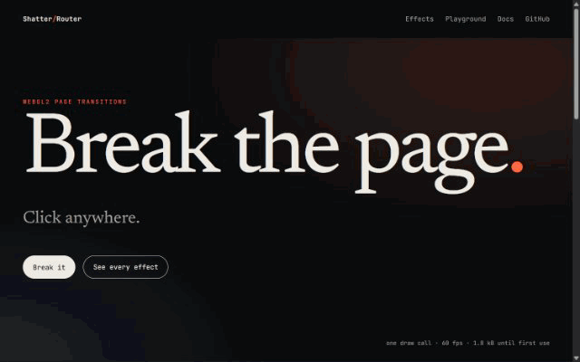

# shatter-router

**Break the page.** WebGL2 glass-shatter page transitions for single-page apps: vanilla, React, React Router and Next.js.



```bash
pnpm add shatter-router
```

```tsx
import { ShatterProvider, ShatterLink } from 'shatter-router/next';

<ShatterProvider>
  <ShatterLink href="/work">Work</ShatterLink>
</ShatterProvider>;
```

| Entry point                   | For                                                                            |
| ----------------------------- | ------------------------------------------------------------------------------ |
| `shatter-router`              | Vanilla: `createShatter()`, `transition({ commit })`, the link rules           |
| `shatter-router/react`        | Any React router (`navigate` prop)                                             |
| `shatter-router/react-router` | React Router 7 (`createShatterBrowserRouter`, `ShatterLink`, `ShatterNavLink`) |
| `shatter-router/next`         | Next.js App Router (`ShatterProvider`, `ShatterLink`)                          |
| `shatter-router/rapier`       | Optional Rapier physics (`@dimforge/rapier3d-compat` peer)                     |

- 1.8 kB up front; the renderer, effects and capture load on idle.
- 60 fps with 160 shards, one draw call per frame, no allocations in the render loop.
- Effects: `shatter`, `explode`, `implode`, `flip`, `assemble`, or your own.
- Navigation always completes: no WebGL2, reduced motion, a slow capture or an error fall back to a crossfade or an instant swap.

Documentation, performance numbers, browser support and the roadmap: [github.com/abdullahasghar966/shatter-router](https://github.com/abdullahasghar966/shatter-router#readme).

MIT licensed.
